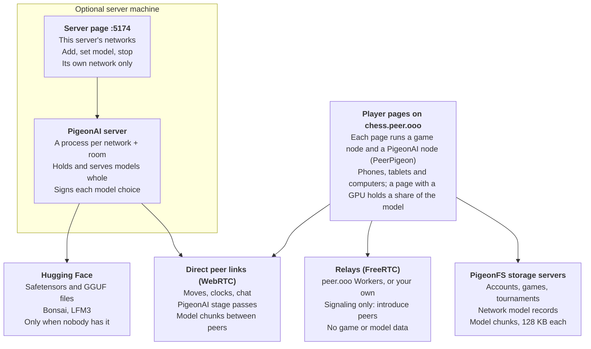
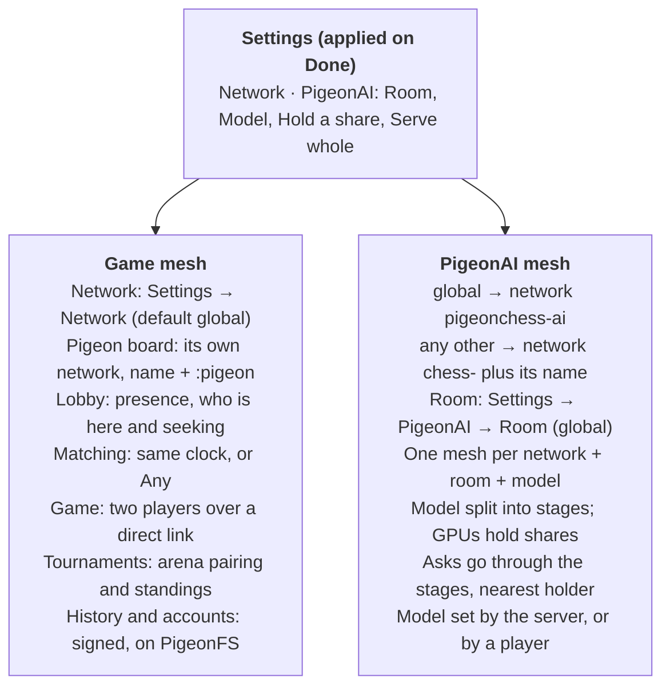
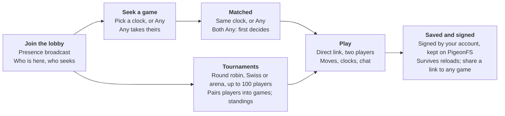
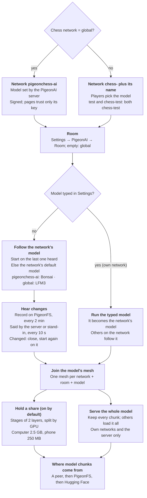
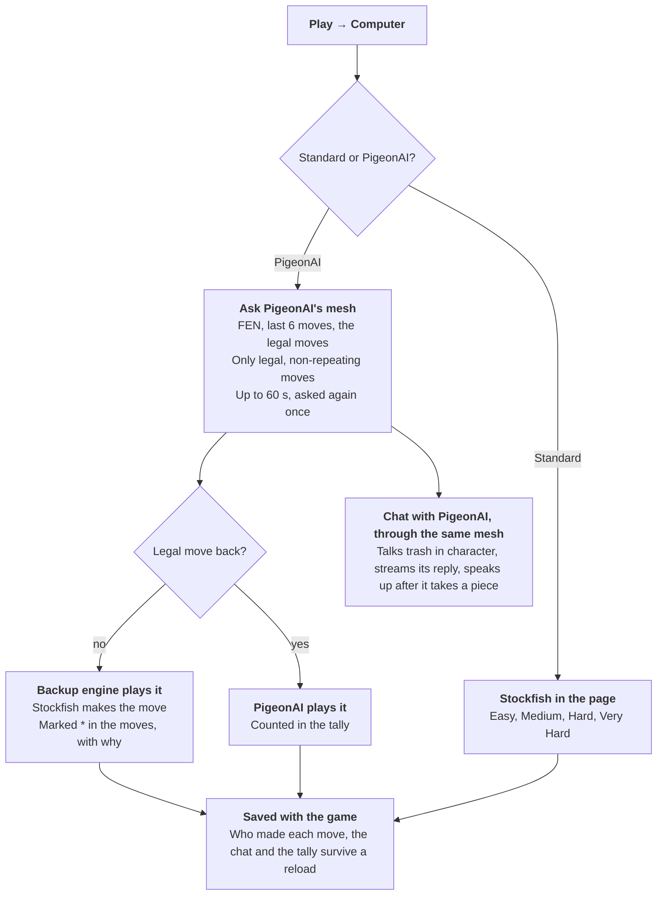
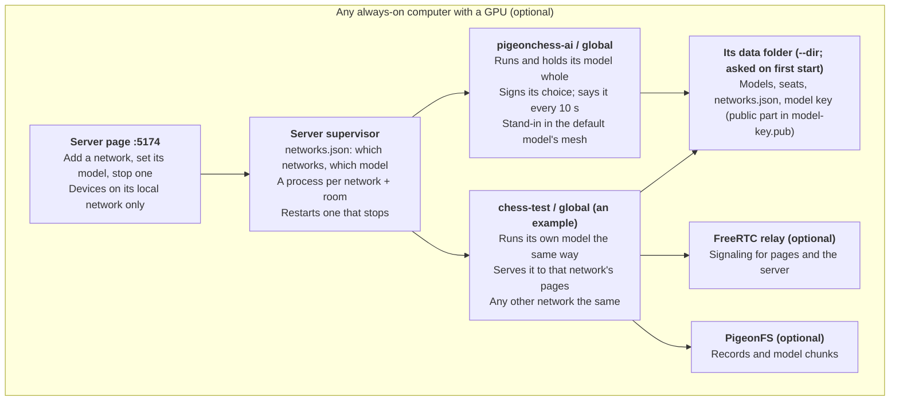

# PigeonChess architecture

## Overview

Relays only introduce peers; moves, chat and model passes go peer to peer, and records live on PigeonFS.

## Inside a page

The two meshes never share peers: the chess network name only decides which PigeonAI network the page joins.

## Regular play

Everything here runs in the game mesh of the network named in Settings; no server referees a game.

## PigeonAI: network, room and model

On global nobody but the server changes the model; on a network of your own, the last player to pick one sets it for everyone there.

## Playing the computer

A PigeonAI game never stalls: when the mesh can't answer in time, Stockfish moves and the move is marked.

## A PigeonAI server

Start it with `npm run server` in a PigeonAI checkout; every network it runs comes back from networks.json. A server can set the model of networks of its own; on global and pigeonchess-ai, pages take a model only from servers whose key PigeonAI trusts.
